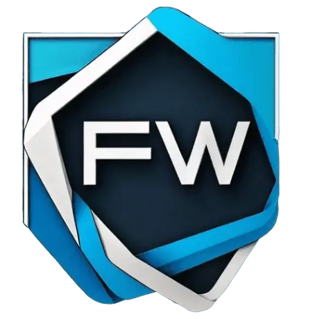

<div align="center">



# FullWeb

**Landing page de FullWeb, emprendimiento de desarrollo de software a medida.**

🌐 [fullwebportfolio.com](https://fullwebportfolio.com)


</div>

---

## Sobre el proyecto

FullWeb ofrece sitios web, aplicaciones web y soluciones de software adaptadas a cada negocio. Esta landing es su sitio institucional y tiene un objetivo concreto: **convertir visitantes en clientes potenciales**. Para eso presenta a la marca, muestra los servicios, explica por qué elegirla y hace fácil ponerse en contacto.

Está pensada para pymes, emprendedores y profesionales independientes que necesitan presencia digital o un sistema a medida.

## Características

- **Página única con navegación por anclas**: Inicio, ¿Por qué elegir a FullWeb?, Servicios y Contacto, con menú responsive.
- **Formulario de contacto funcional**: validación en cliente y servidor con un único schema de Zod, envío por email con Nodemailer desde una Server Action.
- **Botón flotante de WhatsApp** para consultas rápidas.
- **Animaciones al hacer scroll** con `IntersectionObserver` y transiciones de Tailwind, sin librerías extra.
- **SEO**: metadata y Open Graph, `robots.txt`, `sitemap.xml`, datos estructurados JSON-LD (`ProfessionalService`), íconos y página 404 propia.
- **Responsive** en móvil, tablet y escritorio.

## Stack

| Tecnología | Uso |
| --- | --- |
| [Next.js 16](https://nextjs.org) (App Router) | Framework del sitio |
| [React 19](https://react.dev) | UI |
| [TypeScript](https://www.typescriptlang.org) | Tipado |
| [Tailwind CSS 4](https://tailwindcss.com) | Estilos |
| Server Actions | Procesar el formulario de contacto en el servidor |
| [Nodemailer](https://nodemailer.com) | Envío de las consultas por email |
| [Zod](https://zod.dev) + [React Hook Form](https://react-hook-form.com) | Schema y validación del formulario |
| [Bootstrap Icons](https://icons.getbootstrap.com) | Íconos |

## Cómo funciona el formulario

1. React Hook Form valida los datos en el cliente con el schema de Zod.
2. Si son válidos, se llama a la Server Action `actions/contact.ts`.
3. La Server Action **vuelve a validar** con el mismo schema (nunca se confía solo en el cliente).
4. Nodemailer envía el email al correo de FullWeb, con `reply-to` apuntando al visitante.
5. El cliente muestra un mensaje de éxito o de error.

Las credenciales SMTP viven solo en el servidor: `utils/mailer.ts` importa `server-only`, así que no pueden terminar en el bundle del cliente.

## Empezar

### Requisitos

- Node.js 20 o superior
- Una cuenta SMTP para enviar los emails del formulario

### Instalación

```bash
git clone <url-del-repositorio>
cd fullweb-landing-page
npm install
```

### Variables de entorno

Creá un archivo `.env.local` en la raíz:

```env
SMTP_HOST=
SMTP_PORT=
SMTP_USER=
SMTP_PASS=
CONTACT_EMAIL=          # correo que recibe las consultas
NEXT_PUBLIC_SITE_URL=   # http://localhost:3000 en desarrollo, https://fullwebportfolio.com en producción
```

### Scripts

| Comando | Descripción |
| --- | --- |
| `npm run dev` | Servidor de desarrollo en [localhost:3000](http://localhost:3000) |
| `npm run build` | Build de producción |
| `npm run start` | Sirve el build de producción |
| `npm run lint` | Corre ESLint |

## Estructura

```
app/
  layout.tsx        ← layout raíz, fuente Poppins, metadata
  page.tsx          ← arma la landing + JSON-LD
  robots.ts / sitemap.ts / not-found.tsx
actions/
  contact.ts        ← Server Action del formulario
components/
  layout/           ← Header, Footer
  sections/         ← Hero, WhyUs, Services, Contact
  ui/               ← Button, ContactForm, Reveal, ServiceCard, WhatsAppButton...
schemas/
  contact.schema.ts ← schema de Zod + tipo inferido
types/              ← tipos compartidos
utils/
  mailer.ts         ← transporter de Nodemailer (solo servidor)
```

## Identidad visual

| Primario | Secundario | Terciario | Cuaternario |
| --- | --- | --- | --- |
| `#081F5C` | `#334EAC` | `#7096D1` | `#D0E3FF` |

Los colores están definidos como tokens en `app/globals.css` (`@theme`). La tipografía es **Poppins**, cargada con `next/font`.

## Deploy

El sitio está desplegado en **Vercel** con el dominio [fullwebportfolio.com](https://fullwebportfolio.com). Para desplegar tu propia copia, importá el repo en Vercel y cargá las mismas variables de entorno en la configuración del proyecto.

---

<div align="center">

Hecho por **FullWeb** · [fullwebportfolio.com](https://fullwebportfolio.com)

</div>
